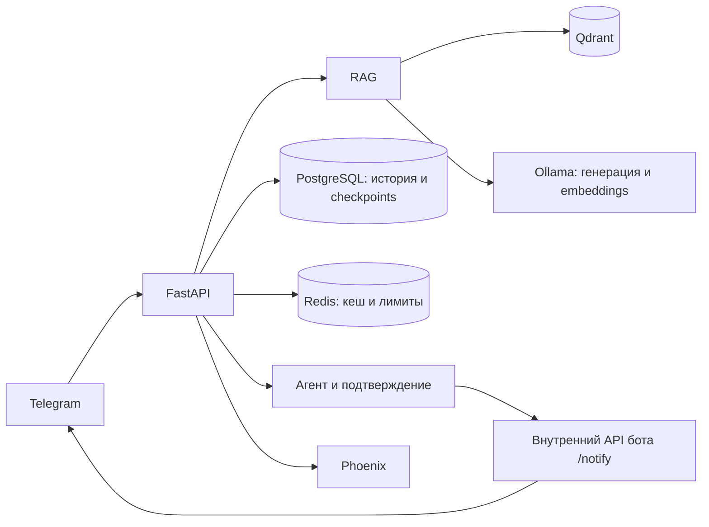

# ИИ ассистент для разработки и ревью кода

Backend дипломного проекта. Помогает разбирать Python-код и
Ansible playbook, отвечает по базе PEP, документации Ansible и чеклистам,
сохраняет историю диалога и выполняет агентные действия с подтверждением.
Пользовательский интерфейс — [Telegram-бот](https://github.com/Frolls/telegram-review-bot).

Сервис построен на FastAPI, LlamaIndex и LangGraph. В демонстрационном стенде
генерация и embeddings работают через локальную Ollama, история и checkpoints —
в PostgreSQL, поиск — в Qdrant, кеш и лимиты запросов — в Redis, трассировка — в Phoenix.

## Запуск полного стенда

Для воспроизведения диплома нужны **два репозитория и приложенные автором файлы
общего запуска**. Одного клонирования репозиториев недостаточно для этого варианта.
Общие `compose.yaml`, `.env.example`, README, `docs/` и `scripts/` передаются
отдельно с материалами защиты.

Разместите их в одной рабочей папке, например `Diploma/`, и из неё выполните:

```bash
git clone https://github.com/Frolls/Review_assistant.git Review_bot
git clone https://github.com/Frolls/telegram-review-bot.git telegram-review-bot
# При повторной настройке сохраните существующий .env.
if [ ! -e .env ]; then cp .env.example .env; fi
```

Получится следующая структура:

```text
Diploma/
├── compose.yaml           # общий запуск из комплекта защиты
├── .env.example
├── .env                   # локальные настройки и ключи
├── README.md
├── docs/
├── scripts/
├── Review_bot/            # этот репозиторий
└── telegram-review-bot/
```

Нужны Docker с Compose и Ollama на хосте, доступная из контейнеров по
`http://host.docker.internal:11434`. Ollama запускается отдельно от Compose;
она должна принимать подключения с контейнерной сети, а не только с loopback.
Заранее загрузите модели:

```bash
ollama pull qwen3:8b
ollama pull qwen3-embedding:4b
```

В **общем** `.env` укажите действующий `BOT_TOKEN`, свои `INTERNAL_TOKEN` и
`ADMIN_TOKEN`. Общий Compose передаст одинаковые ключи обоим сервисам.
Основные настройки модели в приложенном шаблоне:

```dotenv
OPENAI_API_KEY=ollama
OPENAI_BASE_URL=http://host.docker.internal:11434/v1
DEFAULT_MODEL=qwen3:8b
EMBEDDING_MODEL=qwen3-embedding:4b
EMBEDDING_DIM=2560
RAG_SCORE_THRESHOLD=0.5
```

Из общей папки `Diploma/`:

```bash
docker compose -f compose.yaml up -d --build
docker compose -f compose.yaml ps
curl --fail http://localhost:8000/ready
```

Запускаются API, бот, PostgreSQL, Redis, Qdrant и Phoenix. До запуска API
выполняются индексация корпуса и миграции БД; первая индексация может занять
несколько минут. Бот начинает работу после готовности API.

- [Swagger](http://localhost:8000/docs) — интерактивный API.
- [Readiness](http://localhost:8000/ready) — Redis, PostgreSQL, Qdrant, API модели, RAG и агент.
- [Phoenix](http://localhost:6006) — трассы запросов.
- В Telegram отправьте своему боту `/start`, затем вопрос или файл кода.

Для диагностики из общей папки:

```bash
docker compose -f compose.yaml logs --tail=100 app bot
```

Общий Compose публикует порты только на loopback хоста и сохраняет данные в
volumes, включая журнал доставки сообщений бота. `down` останавливает стек;
добавление `-v` удаляет его постоянные данные.

### Какой Compose использовать

| Файл | Назначение |
| --- | --- |
| `Diploma/compose.yaml` из комплекта защиты | Основной запуск всего стенда, один общий `.env`, постоянный журнал доставки бота |
| `Review_bot/compose.yaml` в этом репозитории | Отдельная конфигурация разработки и учебных экспериментов, в том числе профиль `eval` |

Конфигурация внутри репозитория использует `Review_bot/.env` и
`telegram-review-bot/.env`, публикует порты на всех интерфейсах и не монтирует
постоянный volume журнала доставки бота. Она не является копией общего Compose.
Не запускайте обе конфигурации одновременно: имена проекта, порты и ресурсы
могут пересечься. Для защиты используйте команды выше из общей папки.

## Возможности и API

| Путь | Назначение |
| --- | --- |
| `POST /rag/query` | Ответ по базе знаний: `answer`, `confident`, `top_score`, `sources` |
| `POST /chat`, `POST /chat/stream` | Запрос к модели без серверной истории; обычный ответ или SSE |
| `POST /chats` | Создание диалога пользователя |
| `POST /chats/{chat_id}/messages` | Диалог с историей, SSE; multipart-поля `content` и необязательное `media` |
| `DELETE /chats/{chat_id}/messages` | Очистка истории своего диалога |
| `POST /chats/{chat_id}/messages/{message_id}/feedback` | Обратная связь по ответу |
| `POST /agent/stream` | Persistent ReAct с инструментами и подтверждением действий |
| `GET /agent/pending` | Ожидающее действие текущего пользователя |
| `POST /agent/review` | Отдельный supervisor: researcher → writer |
| `POST /documents/upload` | Административная загрузка в общую базу знаний |
| `/chats/admin/*` | Статистика, пользователи и очередь рассылки |
| `GET /health`, `GET /ready` | Проверка процесса и готовности зависимостей |
| `GET /models` | Статический каталог; не список фактически загруженных моделей Ollama |

`POST /notify` обслуживается **ботом**, а backend вызывает его для отправки
подтверждённого сообщения в Telegram.

### Авторизация

Пользовательские endpoint требуют `X-Internal-Token` и `X-User-ID`.
Первый удостоверяет доверенный интерфейс, второй задаёт его пользователя.
Бот берёт ID из Telegram update. Ключ интерфейса не предназначен для передачи
конечному пользователю. История и состояние агента привязаны к этому ID.

В Swagger оба значения задаются через **Authorize**. Проверки `/health`, `/ready`
и страницы документации доступны без ключей. `/chats/admin/*` проверяет
`X-Admin-Token`; загрузка `/documents/upload` требует все три заголовка.
При создании `/chats` поле `owner_external_id` должно совпадать с `X-User-ID`;
переопределение `system_prompt` через этот endpoint запрещено.

Пример запроса RAG из доверенного клиента. Подставьте ключ backend вместо заглушки:

```bash
curl --fail-with-body http://localhost:8000/rag/query \
  -H 'Content-Type: application/json' \
  -H 'X-Internal-Token: REPLACE_WITH_INTERNAL_TOKEN' \
  -H 'X-User-ID: 4242' \
  -d '{"question":"Как скрыть пароль в Ansible diff?"}'
```

В комплекте защиты есть клиент, который читает ключ из общего `.env`:

```bash
# Из Diploma/
python3 scripts/demo.py ansible
```

Он показывает ответ и источники; сценарии клиента не подтверждают отправку
сообщений в Telegram.

## Поиск, вложения и агенты

RAG использует корпус из 56 HTML/Markdown-документов. Конвейер разбивает текст
на фрагменты 256/32 токена, извлекает до 10 кандидатов, применяет порог **к каждому
фрагменту** и передаёт модели до пяти фрагментов. В стенде порог 0.5, reranker
выключен. Дополнительный вызов модели проверяет понятность вопроса и достаточность
фактов: результатом может быть ответ, уточнение или отказ. Эта проверка также
может ошибаться. Уточнения и отказы не показывают источники.

Ссылки в ответе должны соответствовать найденным источникам. Неизвестный номер
приводит к отказу; отсутствующая ссылка не дописывается автоматически.
Само наличие ссылки не доказывает правильность ответа.

Вложение в Telegram анализируется в контексте личного диалога и **не пополняет
общий корпус**. Бот принимает PDF, DOCX и текстовые файлы кода до 10 МиБ.
Для общей базы администратор отдельно вызывает `/documents/upload`
с PDF/DOCX/HTML/Markdown до 50 МиБ. Ответ `202 Accepted` означает принятие файла;
фоновую индексацию нужно проверить по логам.

`/agent/stream` сохраняет checkpoints в PostgreSQL. Отправка сообщения в свой
Telegram-чат приостанавливается до подтверждения пользователя; продолжение
требует `thread_id`, `request_id` ожидающего действия и `resume: true` или
`resume: false`. `/agent/review` — отдельный запуск researcher → writer,
а не автоматическое переключение любого вопроса в многоагентный режим.



## Настройки

[Шаблон этого репозитория](.env.example) предназначен для отдельной конфигурации
backend. Для общего запуска редактируйте `.env` рядом с общим `compose.yaml`.
Значения ниже относятся к общему стенду; все настройки и кодовые defaults
перечислены в [Settings](app/core/config.py).

| Переменные | Назначение |
| --- | --- |
| `OPENAI_BASE_URL`, `OPENAI_API_KEY`, `DEFAULT_MODEL` | Адрес, ключ и модель OpenAI-совместимого сервиса |
| `EMBEDDING_BASE_URL`, `EMBEDDING_API_KEY` | Отдельный сервис embeddings; пустые значения наследуют общие настройки |
| `EMBEDDING_MODEL`, `EMBEDDING_DIM` | Модель векторизации и размерность; в шаблоне `qwen3-embedding:4b`, `2560` |
| `RAG_COLLECTION` | Коллекция RAG; шаблон — `corporate_rag`, измеренный стенд — `corporate_rag_rules_v3` |
| `RAG_CHUNK_SIZE`, `RAG_CHUNK_OVERLAP` | Размер и перекрытие фрагментов: `256`, `32` |
| `RAG_SIMILARITY_TOP_K`, `RAG_RERANKER_TOP_N` | Число кандидатов и фрагментов ответа: `10`, `5` |
| `RAG_SCORE_THRESHOLD`, `RAG_RERANKER_ENABLED` | Порог `0.5`, reranker выключен; кодовый default порога без настройки — `0.3` |
| `RAG_PIPELINE_STORAGE_DIR`, `EMBEDDING_CACHE_PATH` | Docstore и кеш embeddings; в Compose хранятся в volume |
| `REQUEST_TIMEOUT`, `LLM_NUM_CTX`, `LLM_MAX_CONCURRENCY` | Таймаут, контекст и ограничение параллелизма модели |
| `DATABASE_URL`, `CHAT_REPOSITORY` | История диалога; Compose задаёт PostgreSQL |
| `AGENT_CHECKPOINTER`, `POSTGRES_*` | Хранилище состояния агента; Compose задаёт PostgreSQL |
| `REDIS_URL`, `CACHE_TTL_SECONDS`, `RATE_LIMIT_PER_MIN` | Redis, срок кеша и лимит запросов |
| `BOT_URL`, `INTERNAL_TOKEN`, `ADMIN_TOKEN` | Внутренний адрес бота и ключи доступа |
| `PHOENIX_TRACING_ENABLED`, `PHOENIX_COLLECTOR_ENDPOINT` | Экспорт трасс |
| `OBSERVABILITY_INCLUDE_CONTENT` | Запись текстов в трассы; в демошаблоне `true`, для чувствительных данных отключается |
| `MODERATION_OPENAI_ENABLED` | Внешний Moderation API; для Ollama выключен |
| `SECURITY_GUARDRAILS_ENABLED` | Защитный слой обычного чата |
| `VISION_MODEL` | Модель анализа изображений; требуется поддержка vision |

Смена embedding-модели требует совместимой размерности и новой коллекции либо
переиндексации. Внешний OpenAI-совместимый провайдер подключается настройками;
для агентного режима нужна поддержка вызова инструментов. Примеры прокси:
[LiteLLM](docs/litellm/). Telegram передаёт сообщения через внешнюю платформу,
поэтому текущий стенд не является полностью закрытым контуром.

## Проверки и качество

Из общей папки с приложенными скриптами:

```bash
./scripts/test_all.sh
```

Скрипт запускает тесты backend и бота в контейнерах. Для backend поднимается
отдельная временная PostgreSQL; рабочая БД не используется.
Зафиксированный результат **4 октября 2026 года**: 178 тестов backend и
28 тестов бота, без пропусков. Это дата проверки, а не результат каждого запуска.

Полная повторная оценка RAG **15 октября 2026 года**, порог **0.5**,
35 вопросов, без технических ошибок:

| Метрика | Значение |
| --- | ---: |
| Faithfulness | 0.781 |
| Answer relevancy | 0.780 |
| Context precision | 0.939 |
| Context recall | 0.986 |
| Наличие ссылки | 0.943 |

Получены 33 ответа и два избыточных уточнения; все 35 включены в средние.
Критерий наличия ссылок `> 0.95` не пройден. Это не A/B только порога:
относительно июля изменились код и индекс. Сравнения с облачной моделью
на этом наборе не проводилось; историческое сравнение Qwen3 и Qwen3.5 было локальным.

- [Текущая оценка, ограничения, сырые данные и воспроизведение](docs/rag_evaluation_current.md).
- [Историческая оценка и сравнения конфигураций](docs/rag_evaluation.md).
- [Эксперименты поиска и чанкинга](docs/chunking_experiment.md).
- [Набор из 35 вопросов](tests/eval/golden_dataset.json).

## Документация и учебные эксперименты

- [Архитектурный паспорт учебных этапов](docs/architecture.md), [диалоги](docs/chat.md), [RAG](docs/rag.md).
- [ReAct](docs/agent-react-report.md), [LangGraph](docs/agent-graph-report.md),
  [persistent-агент](docs/agent-persistent-report.md), [supervisor](docs/multi-agent-report.md).
- [Трассировка](docs/observability/README.md).
- [Прежний README с учебными этапами](docs/archive/README-course-history.md).

Отчёты экспериментов фиксируют условия своих прогонов. Для запуска текущего
дипломного стенда используйте начало этого README и общие материалы защиты.
Презентация и сценарий выступления передаются отдельно от репозиториев.
