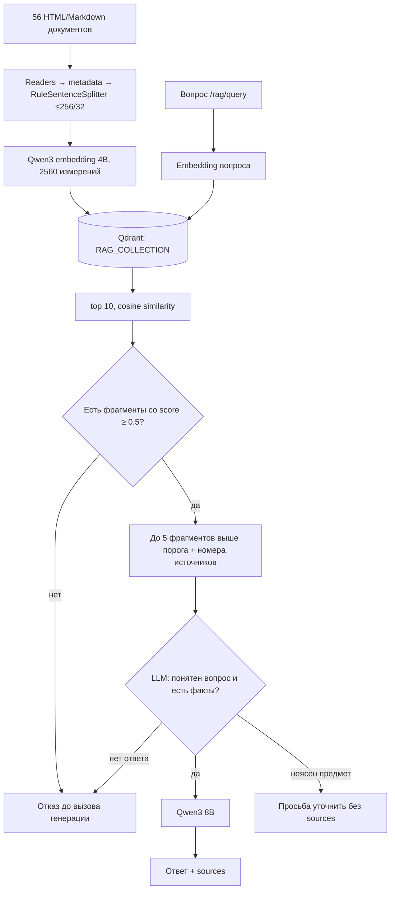
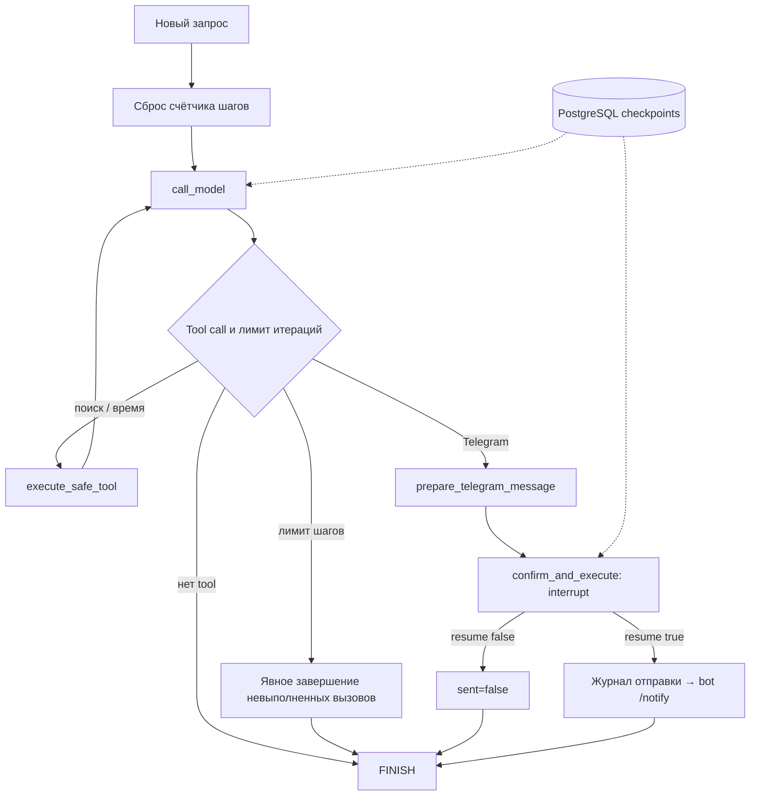
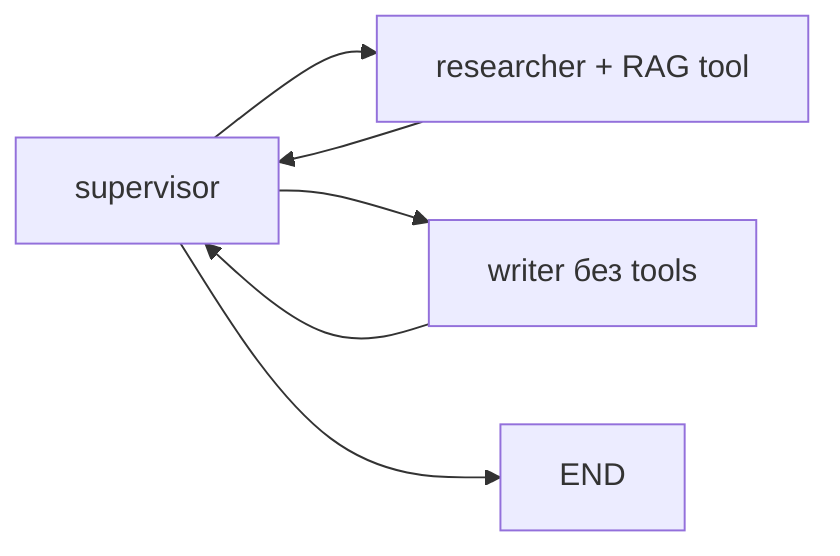

# Архитектура дипломного проекта

Система помогает разработчику разобраться в текущем коде, выбрать исправление
или проверить изменение в PR по правилам Python, Ansible и командным чеклистам.
Код задаёт наблюдаемое поведение, документы и требования задачи — основания замечаний; окончательное решение
о принятии PR принимает человек. Основной интерфейс — Telegram-бот, запускаемый
вместе со стеком. Он обращается к `/chats` для вопросов, файлов и истории,
показывает источники и принимает feedback. Команда `/agent` использует `/agent/stream`: бот показывает результаты инструментов и кнопки подтверждения или отмены.

LLM подключается через OpenAI-совместимый API: локальная Ollama или внешний
провайдер, при необходимости через LiteLLM. В текущей конфигурации модели и
хранилища локальны, но сообщения, вложения и ответы проходят через Telegram.
Полностью закрытый контур потребует внутреннего клиента и локальных
генерации, embeddings, хранилищ и трейсинга.

## Поток вопроса

Ingestion использует постоянный docstore с UPSERT: неизменившиеся документы
повторно не векторизуются. Кеш embeddings и docstore находятся в
`ingestion_storage`. Qdrant, PostgreSQL, Redis и Phoenix имеют свои volumes.
Порог применяется к каждому кандидату до reranking: один сильный результат
не разрешает добавить к контексту слабые соседние фрагменты. Разбиение сохраняет
пробелы и переводы строк; версия обработки входит в hash документа, чтобы UPSERT
обновлял ранее построенные фрагменты после исправления алгоритма.
В подготовленных Markdown-памятках (`retrieval-corpus`, `rag-block-03`) каждый
абзац с правилом обрабатывается отдельно: overlap действует только внутри него.
Заголовок и вводная фраза сохраняются вместе с содержанием. Памятки с блоками
кода и остальные документы используют обычное разбиение SentenceSplitter.
Это уменьшает смешивание правил, но может потерять связи между абзацами;
для произвольных пользовательских документов такой режим не включается.

Проверка перед генерацией получает исходный вопрос, найденные фрагменты и
предыдущие вопросы пользователя, без прежних утверждений ассистента. Она
возвращает JSON-решение; ошибочный формат приводит к отказу. Это дополнительный
вызов той же модели, а не отдельный агент. Он увеличивает задержку и может
ошибаться; полной проверки истинности готового ответа не выполняет.

## Ревью файлов

Вложение не отключает RAG. `ChatService` передаёт текущую задачу и код раздельно,
извлекает запрос к правилам и запускает проверки Python/Ansible. Старый фрагмент
кода в истории не переключает следующие вопросы в режим без поиска.
`mode=transform` действует явно и только на текущий запрос.

Ревью использует Qwen2.5 14B и проверяемые диагностики Ruff/AST/YAML. В дополнение
к 1818 векторным фрагментам есть точный каталог четырёх правил: F821, B012,
mkdir-repeat и secret-debug. Каждое связано с официальной документацией, а
`score=null` отличает точный поиск от embedding similarity. Порог векторного
поиска не снижается. Явные числовые примеры из задачи проверяет ограниченный
AST-интерпретатор без `exec`, импортов, атрибутов и I/O. Он поддерживает простые
функции с одним аргументом и выражением return; неподдерживаемый код не считается
доказанно правильным. Исправления повторно проходят проверки; изменение return
разрешается для подтверждённого дефекта, который затрагивает результат.

Финальный immutable `ReviewAnswer` содержит текст, статус и только опубликованные
источники. Неизвестная ссылка, отказ или блокировка модерацией согласованно
меняют весь результат. HTTP, SSE, история и feedback используют эти данные;
кандидаты retrieval не выдаются за источники отказа. Чистый ответ явно перечисляет
границы выполненных проверок.

## Агент для действий

Режим по умолчанию требует подтверждения; `read-only` запрещает отправку.
API не принимает роль `full` и не позволяет передавать произвольное состояние графа.
ID потока на сервере связан с удостоверенным пользователем. Повторное или чужое
подтверждение отклоняется. Получатель ограничен собственным Telegram ID.
При паузе сохраняется уникальный ID действия. Кнопки остаются применимыми после
перезапуска: `/agent/pending` читает состояние из PostgreSQL.

Инструмент поиска возвращает несколько релевантных фрагментов с именами и номерами
источников. Загрузка общей базы не заменяет используемый RAG-сервис: инструменты
и параллельные запросы продолжают работать с тем же клиентом Qdrant.
Индексация в процессе сериализована.

После поиска агент публикует точную выдержку первого источника с атрибуцией,
без второго свободного пересказа моделью. Это устраняет найденное в live-прогоне
неподтверждённое дополнение об `Optional[T]`. `/clear` очищает чат, checkpoint,
pending action и FSM бота; `/clear_agent` и `/clear_chat` доступны отдельно.
История агента ограничена десятью целыми ходами и 24 000 символами: tool call и
ответ инструмента не разделяются, незавершённое действие сохраняется до решения
или явной очистки. Журнал доставки при очистке не удаляется.

Бот хранит журнал отправок в SQLite на постоянном volume. Уже доставленный запрос
не отправляется повторно. После сбоя с неизвестным результатом автоматическая
повторная отправка блокируется. Это защита от повторов, а не гарантия доставки
ровно один раз; неопределённый результат требует проверки чата.

## Агент для составных ответов

Endpoint `/agent/review` передаёт факты через state; два handoff разделяют
поиск и оформление. Его `InMemorySaver` не переживает перезапуск. PostgreSQL
checkpoints относятся только к `/agent/stream`, история чатов — к `/chats`.

## Сбои

`/health` проверяет жизнь процесса. `/ready` проверяет Redis, PostgreSQL, Qdrant, API списка моделей и инициализацию RAG/агента. Доступность API списка моделей не доказывает успешную генерацию; перед показом нужен реальный вопрос.
При недоступности RAG после старта `/rag/query` возвращает 503. Ingestion
в Compose выполняется до Uvicorn, поэтому ошибка индексации блокирует запуск.
Обычный LLM-сервис ограничивает timeout и повторяет rate limit, SSE агента
сообщает ошибку событием. Автоматического переключения локального Compose
на облачную модель нет; LiteLLM fallback сохранён как отдельный пример.

Подробные прежние схемы: [архитектурный паспорт](../docs/architecture.md)
и [persistent agent](../docs/agent-persistent-report.md).

## Доступ и контекст

Доверенный интерфейс передаёт внутренний ключ и ID пользователя. Сервер проверяет
владельца перед чтением, записью, очисткой и оценкой сообщения. Произвольный
`X-User-ID` без внутреннего ключа не даёт доступа. Общая загрузка документов
дополнительно требует ключ администратора. Это интеграционная авторизация;
при появлении публичного web-клиента потребуется полноценный вход пользователей.

Ответ модели сначала полностью собирается и проверяется модерацией, затем
сохраняется и отдаётся клиенту. Ошибка не сохраняет частичный ответ как завершённый.
История укорачивается по бюджету, сохраняя системные инструкции, текущий запрос
и последнее вложение. Если обязательная часть не помещается, запрос завершается
явной ошибкой. Файлы не обрезаются незаметно и не исполняются.

PDF/DOCX разбираются в двух ограниченных subprocess worker с deadline 20 секунд,
лимитами CPU/памяти и остановкой при отмене. DOCX дополнительно ограничен
2000 ZIP-элементами и 32 MiB распакованных данных. SSE передаёт безопасный progress
каждые 10 секунд, общий deadline хода — 180 секунд. Это буферизация до валидации,
а не видимый поток непроверенных токенов. Измеряются начало и полное время SSE.

`ModelAdapter` объединяет deadline/retry, нормализацию ошибок, usage и версию
prompt для основных сценариев. Usage включает подготовку поиска и usage-only
chunks; отсутствие счётчиков отмечается явно. Redis-кеш относится к stateless
`/chat`, а не к stateful Telegram/RAG/агенту. При
`OBSERVABILITY_INCLUDE_CONTENT=false` custom span и логи, включая condense,
содержат только hash, длины и технические metadata; автоинструментация также
скрывает содержимое. Локальный inference измеряется отдельно от цены API.

`/escalate <вопрос>` создаёт постоянную заявку с ID и статусом `open`, `/ticket`
читает её; API поддерживает отмену. Автоматической передачи специалисту нет.
Проверки, реальные замеры и ограничения: [отчёт v12](verification/README.md).

Compose использует один процесс API. Блокировки чатов, потоков агента и индексации
действуют внутри него. Для нескольких процессов нужны распределённые блокировки.

## Идентичность чата и параллельные запросы

Чат определяется парой `owner_external_id` / `interface`. Системная инструкция
обновляется отдельно от идентичности чата. В PostgreSQL поиск и создание
сериализуются транзакционной advisory-блокировкой по этой паре; история сохраняется.
JSON-реализация поддерживает такой же контракт в пределах одного процесса.

Чат и оба агентных маршрута используют общий `LLM_MAX_CONCURRENCY`. Ожидание
подтверждения пользователем не удерживает слот: генератор завершается после
события `paused`. На продолжении слот занимается заново.
